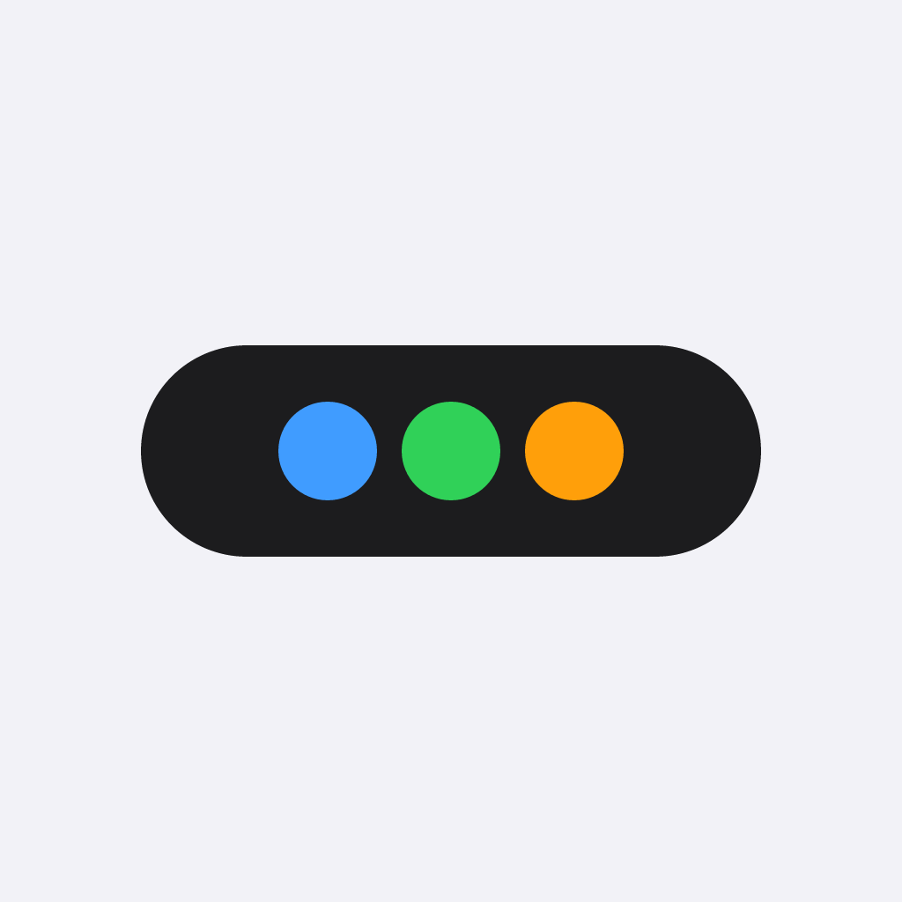

# MicroScritt

<p align="center">
  
</p>

<p align="center">
  <a href="https://github.com/Ricardo-Kaslana/MicroScritt/actions/workflows/ci.yml"></a>
  <a href="LICENSE"></a>
  = 3.35">
</p>

[中文](#中文) | [English](#english)

<a id="中文"></a>

## 中文

移动端优先、本地优先的 AI 角色扮演与创作工作台。基于纯客户端 Flutter,无账号、无项目自有后端、无遥测;数据与任务编排留在你的设备上,LLM 推理和云端生图则由你配置的第三方 API 完成。

> 当前源码 **2.3.4+7** · 数据库基线 **v75** · 主要维护 **Android / Windows**
>
> 主分支包含尚未发布的变更,正式安装包的功能以对应 Release 与 tag 为准。应用界面目前为简体中文。

### 核心功能

- **对话与模型**:OpenAI 兼容与 Anthropic 双协议,provider 分组管理端点和模型;流式输出、七档推理等级、逐模型上下文与输出限制、连接测试和用量统计。
- **角色卡与世界书**:兼容 SillyTavern V1/V2/V3 角色卡及 World Info,支持 JSON 与 PNG 内嵌卡导入、JSON/PNG 导出、常驻或关键词触发词条、正则与选择性触发。
- **可控的长上下文**:统一组装角色设定、提示词、世界书、长期记忆、`@技能`、附件和压缩摘要;可查看各段原文、token 与缓存命中,支持自动或手动压缩。
- **后台状态维护**:Legacy / Agentic / Hybrid 三种模式维护会话变量并自动生图;变量具有权限、显式删除、回收站和严格确认机制,失败或冲突不会污染状态。
- **AI 制卡工作台**:通过对话创建或优化角色卡、世界书和头像提示词;字段级/行级 diff 可逐项接受、拒绝或编辑,支持最终预览、冲突检测、草稿恢复和自动生成头像。
- **可扩展生图**:所有生图服务统一使用单文件 JSON 插件;内置 OpenAI 兼容对话式网关、Nai2API、NovelAI 官方 API 协议插件,也可导入可信的自定义插件。
- **创作扩展**:QuickJS Hook 在五个管线节点改写数据,另有显示层正则、全局提示词、技能和自定义画风;相关资源均可独立导入导出。
- **本地图片资产**:图片按 SHA-256 内容寻址并去重,原图与预览分离,自动维护引用和回收;支持 URL 图片本地化、可选入库压缩及按会话查看占用。
- **归档与迁移**:v5 `.msarc` 流式会话归档可携带图片,兼容 v1–v4 只读导入;支持仅文本导入、多选消息导出、完整应用配置迁移。
- **阅读与个性化**:多会话、置顶、会话内搜索、消息编辑/重写/重新生成、多选删除与导出;宽屏提供会话侧栏和用户消息导航,支持主题、聊天背景与角色气泡样式。

### 平台与下载

| 平台 | 状态 | 安装方式 |
| --- | --- | --- |
| Android | 主要维护平台 | 下载 `microscritt-<版本>-android.apk`,允许未知来源安装后侧载;正式 APK 可覆盖升级 |
| Windows | 主要维护平台 | 下载 `microscritt-<版本>-windows-x64.zip`,解压后运行 `microscritt.exe` |
| iOS | 工程存在,未完整接线且未真机验证 | 无正式安装包;QuickJS 尚未接入,Hook 与生图插件不可用 |

正式构建见 [GitHub Releases](https://github.com/Ricardo-Kaslana/MicroScritt/releases)。Windows 包未做代码签名,首次运行可能触发 SmartScreen;系统需安装 Visual C++ 2015–2022 运行库。项目不内置可用密钥或代理服务,默认 DeepSeek 示例端点可编辑或删除。

### 首次使用

#### 1. 配置 LLM

1. 打开「设置 → LLM 后端」,编辑无密钥的 DeepSeek 示例,或新建 provider。
2. 选择 OpenAI 兼容或 Anthropic 协议,填写 API 地址、API Key;需要时添加自定义请求头。
3. 添加模型并填写模型 ID、展示名和上下文容量。Anthropic 模型必须填写最大输出。
4. 点击「测试连接」,保存配置。
5. 回到聊天页,在输入区的模型胶囊中**选择当前 provider 与模型**。仅保存 provider 不会自动切换当前模型。

API 地址按协议填写:

| 协议 | 地址示例 | 应用追加的路径 |
| --- | --- | --- |
| OpenAI 兼容 | `https://api.example.com/v1` | `/chat/completions` |
| Anthropic | `https://api.example.com` | `/v1/messages` |

#### 2. 开始会话

导入或新建角色卡,然后创建会话。单开场白会自动起笔,多开场白可在新会话中选择。发送消息,或先输入 `/test` 验证生成链路。

#### 3. 可选:配置自动生图

1. 在 Android 或 Windows 上打开「设置 → 生图服务」,选择内置插件或导入可信 JSON 插件。
2. 新建生图配置,填写 Base URL、API Key、模型及插件要求的字段,测试后保存。
3. 多套配置需在列表中指定「当前使用」;随后在会话状态面板启用后台引擎和生图维护。

插件导入示例见 [examples/image_plugins](examples/image_plugins/README.md)。自定义插件包含可执行 JavaScript,只应导入你信任并审查过的文件。

### 斜杠命令

| 命令 | 用途 |
| --- | --- |
| `/test` | 测试生成 |
| `/continue` | 自动推动剧情 |
| `/clear` | 清空当前会话历史 |
| `/compact` | 主动压缩上下文 |
| `/rerun [修改方向]` | 重跑上次后台维护,可附加修改方向 |

桌面端输入 `/` 或 `@` 可打开命令与技能建议,支持方向键、Tab 补全和 Esc 关闭。

### 数据、备份与隐私

桌面端数据位于 `~/.microscritt`,Windows 即 `C:\Users\<用户名>\.microscritt`;移动端使用应用私有目录。数据库、配置、UI 偏好、制卡草稿和图片资产分开保存。

| 导出形式 | 包含 | 不包含 |
| --- | --- | --- |
| `microscritt-config.json` v2 | 用户名、LLM/生图 provider、插件、画风 | 会话、消息、变量、记忆、图片和全部 UI 偏好 |
| v5 `.msarc` 会话归档 | 角色卡/世界书、消息、变量及权限、记忆、图片、会话级用量 | provider 配置、全局资源、变量回收站/待确认删除、全局用量明细 |
| 资源 JSON | 技能、提示词、Hook、正则或画风 | 会话和 provider 配置 |
| 用量 JSON | 总览、每日与模型聚合 | 逐请求原始明细 |

请注意:

- 没有账号、遥测或自动上传日志;LLM 请求会把你配置的提示词、历史和必要状态发送给对应服务。
- 生图结果或历史消息中的图片 URL 也会被下载,其主机不一定与 API 端点相同。
- API Key 以明文保存在 SQLite 和配置文件中;自定义插件代码也可执行。不要公开分享配置文件、数据库或导出归档。
- 卸载应用或删除数据目录会移除本地数据,请提前导出需要保留的内容。
- 详见 [PRIVACY.md](PRIVACY.md) 与 [SECURITY.md](SECURITY.md)。

> **升级前请备份。** 2.0 起数据库不做增量迁移:检测到旧 schema 时会归档原库并按当前基线重建。除 `usage_records` 用量明细外,聊天、角色等业务数据不会自动从归档回灌。升级前请导出会话并备份整个数据目录;旧应用也不能打开更高版本的数据库。
>
> 2.3.0 起 Android/iOS 应用标识发生变化,系统会将其视为新应用,旧安装数据不会自动迁移。

### 已知限制

- iOS 尚未接入 QuickJS,Hook 与生图插件不可用,也未完成真机验证。
- 会话内搜索只扫描文本消息,不覆盖纯图片消息或显示层正则改写后的内容。
- 缺少原始生图描述的旧图片不能重新生成;单图提示词改写只读取文本上下文,不读取图片本身。
- `/rerun` 的精确重放窗口只保留在会话内存中,重启或切换会话后会退化。
- 生图插件不提供本地推理、原生 SDK、自动更新或逐事件 SSE 进度。

### 从源码运行

要求 Flutter 稳定版 **≥ 3.35.0**、Dart **^3.9.2**;CI 使用 Flutter 3.35.5。

```bash
git clone https://github.com/Ricardo-Kaslana/MicroScritt.git
cd MicroScritt
flutter pub get
flutter devices
flutter run -d windows
# 或连接 Android 设备后:
flutter run -d <device-id>
```

常用检查与构建:

```bash
flutter analyze
flutter test
flutter test test/backend
flutter build apk --release
flutter build windows --release
```

生图插件测试需要真实执行 JavaScript,QuickJS 不可用时回落到 Node。若本地使用依赖镜像,提交锁文件前请运行 `PUB_HOSTED_URL=https://pub.dev flutter pub get`,确保 `pubspec.lock` 只包含 pub.dev 地址。

仓库不包含发布签名密钥。本地未配置 `android/key.properties` 时,Android release 构建会使用 debug 签名;正式签名、发布流程与 tag 规则见 [CONTRIBUTING.md](CONTRIBUTING.md)。

### 架构速览

```text
UI(Riverpod) → State / Controllers → Context + Engine → LLM / Image Backend
                                                         → 用户配置的 API
Data Repositories ↔ SQLite / JSON 配置 / 图片资产库
Import / Export ↔ 本地领域模型
```

- LLM 只接收纯文本 `ContextSnapshot` 与结构化工具块,图片不会进入上下文。
- `lib/data` 与 `lib/backend` 不互相 import,只通过 `lib/models` 的中立类型对接。
- 主写是对话消息的唯一生成路径;后台 Agent 与制卡 Agent 的转录不会写入消息表。
- 完整分层、不变量、数据模型和已知局限见 [docs/ARCHITECTURE.md](docs/ARCHITECTURE.md)。

### 文档与社区

- [CHANGELOG.md](CHANGELOG.md):版本与未发布变更
- [CONTRIBUTING.md](CONTRIBUTING.md):开发、测试、提交与发布
- [CODE_OF_CONDUCT.md](CODE_OF_CONDUCT.md):社区行为准则
- [PRIVACY.md](PRIVACY.md) / [SECURITY.md](SECURITY.md):隐私边界与漏洞报告
- [AGENTS.md](AGENTS.md):AI 编码代理速查

欢迎提交 issue 与 PR。内置提示词与示例资产必须为原创中性内容,不接受破限、露骨成人素材、硬编码密钥或未授权第三方文本;安全问题请按安全文档私下报告。

### 许可证与内容声明

项目采用 [MIT](LICENSE) 许可证。

MicroScritt 是通用角色扮演写作工具,不内置规避模型安全策略的指令。自定义内容和你配置的第三方服务由使用者负责,请遵守对应服务条款与当地法律。AI 生成内容可能不准确,请自行判断。

---

<a id="english"></a>

## English

A mobile-first, local-first AI roleplay and creative-writing workspace. Built as a client-only Flutter app with no account, project-operated backend or telemetry. Your data and orchestration stay on your device; LLM inference and cloud image generation are performed by the third-party APIs you configure.

> Current source **2.3.4+7** · database baseline **v75** · primary platforms: **Android / Windows**
>
> The main branch contains unreleased changes. Refer to each Release and tag for the features included in official builds. The app UI is currently Simplified Chinese only.

### Key features

- **Chat and models**: OpenAI-compatible and Anthropic protocols, grouped providers and model catalogs, streaming, seven reasoning levels, per-model context/output limits, connection tests and usage statistics.
- **Character cards and world books**: SillyTavern V1/V2/V3 card and World Info compatibility, JSON and PNG-embedded imports, JSON/PNG exports, constant or keyword-triggered entries, regex and selective activation.
- **Controllable long context**: character details, prompts, world books, long-term memories, `@skills`, attachments and compaction summaries in one pipeline; inspect section text, tokens and cache hits, with automatic or manual compaction.
- **Background state**: Legacy / Agentic / Hybrid modes maintain session variables and generate images. Variable permissions, explicit deletion, a recycle bin and strict confirmation keep failed or conflicting runs from corrupting state.
- **AI card studio**: create or refine cards, world-book entries and avatar prompts through conversation; review field/row-level diffs item by item, preview the result, detect conflicts, restore drafts and generate avatars.
- **Extensible image generation**: every image service uses a single-file JSON plugin. OpenAI-compatible chat gateway, Nai2API and official NovelAI API plugins are built in, and trusted custom plugins can be imported.
- **Creative extensions**: QuickJS hooks at five pipeline stages, display-layer regex, global prompts, skills and custom image styles, each with independent resource import/export.
- **Local image assets**: SHA-256 content addressing and deduplication, separate originals and previews, reference maintenance and recycling, URL-image localization, optional pre-ingest compression and per-session storage reports.
- **Archives and migration**: streaming v5 `.msarc` session archives with images, read-only v1–v4 import, text-only import, selected-message export and complete app-configuration migration.
- **Reading and personalization**: multiple sessions, pinning, in-session search, message editing/rewriting/regeneration, multi-select delete/export, a desktop session sidebar and user-message navigation, themes, chat backgrounds and per-character bubble styles.

### Platforms and download

| Platform | Status | Installation |
| --- | --- | --- |
| Android | Primary platform | Download `microscritt-<version>-android.apk` and sideload it; official APKs support in-place upgrades |
| Windows | Primary platform | Download `microscritt-<version>-windows-x64.zip`, extract it and run `microscritt.exe` |
| iOS | Sources present, incomplete and not device-verified | No official package; QuickJS is not wired, so hooks and image plugins are unavailable |

Official builds are available on [GitHub Releases](https://github.com/Ricardo-Kaslana/MicroScritt/releases). Windows binaries are not code-signed, so SmartScreen may warn on first launch; the Visual C++ 2015–2022 runtime is required. No usable keys or proxy service are bundled, and the default DeepSeek example endpoint can be edited or removed.

### First-time setup

#### 1. Configure an LLM

1. Open **Settings → LLM backends**, edit the keyless DeepSeek example or add a provider.
2. Select the OpenAI-compatible or Anthropic protocol, then enter the API base URL and key; add custom headers if needed.
3. Add a model with its model ID, display name and context capacity. Anthropic models require a maximum output value.
4. Use **Test connection**, then save.
5. Return to chat and **select the active provider and model** from the model capsule in the composer. Saving a provider alone does not select its model.

Base URL conventions:

| Protocol | Example base URL | Path appended by the app |
| --- | --- | --- |
| OpenAI-compatible | `https://api.example.com/v1` | `/chat/completions` |
| Anthropic | `https://api.example.com` | `/v1/messages` |

#### 2. Start a session

Import or create a character card, then create a session. A single greeting starts automatically; multiple greetings can be selected in each new session. Send a message, or enter `/test` first to verify the generation path.

#### 3. Optional: configure automatic image generation

1. On Android or Windows, open **Settings → Image services** and choose a built-in plugin or import a trusted JSON plugin.
2. Add an image configuration with its base URL, API key, model and plugin-specific fields, then test and save it.
3. If you have multiple configurations, mark one as active; then enable the background engine and image maintenance in the session status panel.

See the [image plugin example](examples/image_plugins/README.md). Custom plugins contain executable JavaScript; only import files you trust and have reviewed.

### Slash commands

| Command | Purpose |
| --- | --- |
| `/test` | Test generation |
| `/continue` | Advance the story automatically |
| `/clear` | Clear the current session history |
| `/compact` | Compact the context manually |
| `/rerun [instruction]` | Rerun the last background maintenance, optionally with new instructions |

On desktop, typing `/` or `@` opens command and skill suggestions with arrow-key navigation, Tab completion and Esc to dismiss.

### Data, backups and privacy

Desktop data lives in `~/.microscritt`, or `C:\Users\<user>\.microscritt` on Windows. Mobile uses app-private storage. The database, configuration, UI preferences, card-studio drafts and image assets are stored separately.

| Export | Includes | Does not include |
| --- | --- | --- |
| `microscritt-config.json` v2 | Username, LLM/image providers, plugins and styles | Sessions, messages, variables, memories, images or all UI preferences |
| v5 `.msarc` session archive | Card/world book, messages, variables and permissions, memories, images and session-level usage | Provider settings, global resources, variable trash/deletion proposals or global usage records |
| Resource JSON | Skills, prompts, hooks, regex or styles | Sessions and provider settings |
| Usage JSON | Overall, daily and per-model aggregates | Raw per-request records |

Please note:

- There are no accounts, telemetry or automatic log uploads. LLM requests send your configured prompts, history and required state to the selected service.
- Image URLs returned by generators or stored in earlier messages are also downloaded, and their hosts may differ from the API endpoint.
- API keys are stored in plaintext in SQLite and the configuration file. Custom plugin code is executable. Never publicly share configuration files, databases or exported archives.
- Uninstalling the app or deleting its data directory removes local data; export anything you need first.
- See [PRIVACY.md](PRIVACY.md) and [SECURITY.md](SECURITY.md) for details.

> **Back up before upgrading.** Since 2.0, the database has no incremental migration chain: an older schema is archived and a fresh current baseline is created. Except for `usage_records`, chats, characters and other business data are not automatically restored from the archive. Export sessions and back up the entire data directory first. Older app versions also cannot open a newer database.
>
> Since 2.3.0, the Android/iOS application identifier has changed. The OS treats it as a new app, and data from an older installation is not migrated automatically.

### Known limitations

- iOS has no QuickJS bridge yet, so hooks and image plugins are unavailable; it has not been verified on a physical device.
- In-session search only scans text messages, not image-only messages or text produced by display-layer regex.
- Older images without an original generation prompt cannot be regenerated; single-image prompt rewriting reads text context, not the image itself.
- The precise `/rerun` replay window is memory-only and degrades after restarting or switching sessions.
- Image plugins do not provide local inference, native SDKs, automatic updates or event-by-event SSE progress.

### Run from source

Requirements: stable Flutter **≥ 3.35.0** and Dart **^3.9.2**. CI uses Flutter 3.35.5.

```bash
git clone https://github.com/Ricardo-Kaslana/MicroScritt.git
cd MicroScritt
flutter pub get
flutter devices
flutter run -d windows
# Or, with an Android device connected:
flutter run -d <device-id>
```

Common checks and builds:

```bash
flutter analyze
flutter test
flutter test test/backend
flutter build apk --release
flutter build windows --release
```

Image-plugin tests execute real JavaScript and fall back to Node when QuickJS is unavailable. If you use a package mirror, run `PUB_HOSTED_URL=https://pub.dev flutter pub get` before committing the lockfile so that `pubspec.lock` only contains pub.dev URLs.

Release signing keys are not included. Without a local `android/key.properties`, Android release builds use debug signing. See [CONTRIBUTING.md](CONTRIBUTING.md) for official signing, releases and tag rules.

### Architecture overview

```text
UI (Riverpod) → State / Controllers → Context + Engine → LLM / Image Backend
                                                           → Your configured APIs
Data Repositories ↔ SQLite / JSON configuration / image asset store
Import / Export ↔ Local domain models
```

- The LLM receives only a plain-text `ContextSnapshot` and structured tool blocks; images never enter the context.
- `lib/data` and `lib/backend` never import each other and meet through neutral types in `lib/models`.
- The main writer is the only generation path for chat messages; background and card-studio agent transcripts are not written to the message table.
- See [docs/ARCHITECTURE.md](docs/ARCHITECTURE.md) (Chinese) for full layering, invariants, the data model and known limitations.

### Documentation and community

- [CHANGELOG.md](CHANGELOG.md): released and unreleased changes
- [CONTRIBUTING.md](CONTRIBUTING.md): development, tests, commits and releases
- [CODE_OF_CONDUCT.md](CODE_OF_CONDUCT.md): community standards
- [PRIVACY.md](PRIVACY.md) / [SECURITY.md](SECURITY.md): privacy boundaries and vulnerability reporting
- [AGENTS.md](AGENTS.md): AI coding-agent quick reference

Issues and pull requests are welcome. Built-in prompts and example assets must be original, neutral content; jailbreak material, explicit adult content, hardcoded keys and unauthorized third-party assets are not accepted. Report security issues privately using the security policy.

### License and content disclaimer

Licensed under [MIT](LICENSE).

MicroScritt is a general-purpose roleplay writing tool and does not bundle instructions for bypassing model safety policies. You are responsible for custom content and third-party services you configure; follow their terms and applicable laws. AI-generated content may be inaccurate, so use your own judgement.
