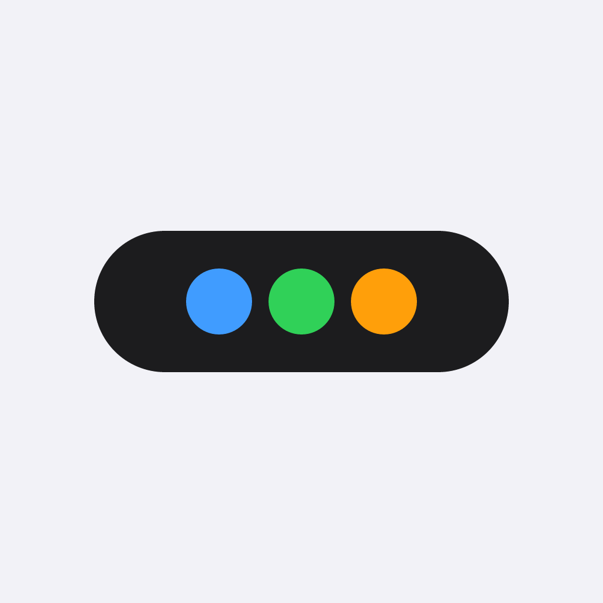

# MicroScritt

<p align="center">
  
</p>

<p align="center">
  <a href="https://github.com/Ricardo-Kaslana/MicroScritt/actions/workflows/ci.yml"></a>
  <a href="LICENSE"></a>
  = 3.35">
</p>

[中文](#中文) | [English](#english)

<a id="中文"></a>

## 中文

移动端优先的极简 AI 角色扮演(RP)聊天应用。纯客户端 Flutter,无后端服务:对话、生图、Hook 脚本执行与数据存储全部在本地完成。

> 当前版本 **2.3.0** · 数据库 schema **v66** · Android / Windows 可用;iOS 源码存在,但 JS runtime 尚未接线,生图在这些平台不可用。

### 功能

- **多后端对话**:OpenAI 兼容与 Anthropic 双协议,按 provider 分组管理多套配置与模型目录;流式输出、用量统计、上下文占用环形图。
- **上下文组装管线**:角色卡 / 预设提示词 / 世界书 / 记忆 / @技能 / 压缩摘要统一组装为纯文本上下文;附件式注入、单轮限额、按 token 占用率自动压缩,兼容上游提示缓存。
- **后台维护引擎**:回复落库后由后台 agent 维护变量与自动生图;失败跳过、不落库、不掉轮。变量支持三档权限、显式删除、回收站与严格模式待确认。
- **角色卡导入导出**:SillyTavern V2/V3 角色卡(JSON 与 PNG 内嵌),世界书条目与 SillyTavern World Info 双向导入导出;支持 PNG 角色卡导出。
- **生图插件**:单文件 JSON 插件接入 HTTP(S) 生图服务;内置 OpenAI 兼容对话式网关与 Nai2API 两个协议插件,也可导入自定义插件。画面风格预设与自定义风格管理,生成图本地化落库。**不内置任何可用密钥或代理服务**,服务地址由用户配置。
- **Hook 脚本**:QuickJS 沙箱执行 JS,在输入改写 / 上下文组装 / 生成前 / 流式后 / 落库前五个触发点改写数据;另有显示层正则脚本。
- **本地优先**:全部数据存于本地 SQLite;会话归档流式导入导出(支持超大带图会话),角色卡 JSON/PNG 导出,桌面端 `.part` 原子写入,移动端可保存到本地或系统分享。
- **端点兼容选项**:工具通道回复 / 提示词随机前缀,按 provider 声明式开启,默认全关。

### 平台支持

| 平台 | 状态 |
| --- | --- |
| Android | 主要维护平台,可构建运行 |
| Windows | 主要维护平台,可构建运行 |
| iOS | 源码存在,JS runtime 未接线,生图不可用;未在真机完整验证 |

最低工具链:Flutter 3.35 / Dart 3.9。

### 快速开始

```bash
git clone https://github.com/Ricardo-Kaslana/MicroScritt.git
cd MicroScritt
flutter pub get
flutter analyze
flutter test
flutter build apk --release        # Android
flutter build windows --release    # Windows
```

仓库不内置发布签名密钥;Android release 默认使用 debug 签名,分发前请配置自己的 keystore。

### 配置

1. 打开「设置 → LLM Provider」,新建或编辑 provider,填写 API 地址、API Key 与模型;
2. 首次启动会种入一个**无密钥的 DeepSeek 示例 provider**,可直接填入自己的 Key,也可以修改地址或删除后新建;
3. 用「测试连接」确认端点和密钥可用;
4. 生图在「设置 → 生图服务」中导入插件或选择内置协议插件,再填写 Base URL、Key 与模型;
5. Hook、正则脚本、预设提示词、技能与世界书均在对应管理页维护。

桌面端数据目录为 `~/.microscritt`(Windows 即 `C:\Users\<用户名>\.microscritt`):数据库、图片缓存、`microscritt-config.json` 与 `ui-prefs.json` 都在这里。移动端使用应用私有目录。`microscritt-config.json` 含**明文 API Key**,请勿公开分享。

### 数据与隐私

- 无账号、无遥测、无后端;网络请求只发往你配置的 LLM / 生图端点。
- 所有对话、角色卡、变量与图片保存在本地 SQLite 与数据目录。
- 导出的会话归档、配置文件与图片可能包含 API Key 或私密内容,分享前请自行检查。
- 详见 [PRIVACY.md](PRIVACY.md) 与 [SECURITY.md](SECURITY.md)。

### 架构

```
Data(sqflite) → Backend(LLM/生图抽象) → Context(组装管线)
→ Engine(单写对话 + 后台双写 + Hook) → Import/Export → UI(Riverpod)
```

- LLM 只接收纯文本 `ContextSnapshot`;图片与富媒体绝不进上下文。
- 持久化层与 LLM/生图层不互相 import,只通过 `lib/models/` 的中立类型对接。
- 数据库 schema 为 v66 单一基线;2.0 之前的旧库在首次启动时归档重建。
- 更多设计说明见 [docs/ARCHITECTURE.md](docs/ARCHITECTURE.md);AI 编码代理速查见 [AGENTS.md](AGENTS.md)。

### 已知限制

- iOS/macOS 的 JS runtime 未接线,生图插件在这些平台不可用。
- 移动端「保存到本地」与系统分享面板尚未在真机完整验证。
- 会话内搜索使用 `LIKE` 扫描,不对纯图片消息或显示层正则改写内容生效。
- 生图排队进度不逐事件回调,靠响应体提前截断减少等待。

### 贡献

欢迎提交 issue 与 PR。请先阅读 [CONTRIBUTING.md](CONTRIBUTING.md) 与 [CODE_OF_CONDUCT.md](CODE_OF_CONDUCT.md);安全问题请按 [SECURITY.md](SECURITY.md) 私下报告。内置提示词与示例资产必须为原创中性内容,不接受破限、露骨成人素材或未授权第三方文本。

### 许可证

[MIT](LICENSE)。

### 内容声明

本应用是通用角色扮演写作工具,内置提示词均为中性创作辅助内容,不包含规避模型安全策略的指令。使用者通过自定义提示词接入的内容与所配置的第三方服务,责任由使用者自行承担;使用任何第三方 API 服务时请遵守其服务条款。AI 生成内容可能不准确,请自行判断。

---

<a id="english"></a>

## English

A minimal, mobile-first AI roleplay (RP) chat app. Pure client-side Flutter — no backend service: chat, image generation, hook scripts and storage all happen locally on your device.

> Version **2.3.0** · database schema **v66** · Android and Windows are usable; iOS sources exist but the JS runtime is not wired yet, so image generation is unavailable there.

### Features

- **Multi-backend chat**: OpenAI-compatible and Anthropic protocols, grouped per provider with model catalogs; streaming output, token usage tracking and a context-usage ring.
- **Context assembly pipeline**: character cards / prompt presets / world books / memories / @skills / compaction summaries assembled into a plain-text context snapshot; attachment-style injection, per-turn budgets and token-usage-driven auto-compaction that stays cache-friendly.
- **Background maintenance engine**: after each reply lands, a background agent maintains variables and automatic image generation; failures are skipped, never persisted, never fatal.
- **Character card import/export**: SillyTavern V2/V3 cards (JSON and PNG-embedded), two-way world book import/export with SillyTavern World Info, plus PNG card export.
- **Image generation plugins**: single-file JSON plugins for HTTP(S) image services. Two protocol plugins ship with the repo (OpenAI-compatible chat gateway and Nai2API), and you can import your own. Style presets and custom styles are supported. **No usable key or proxy service is bundled**; you configure the service address.
- **Hook scripts**: QuickJS-sandboxed JS at five trigger points (input rewrite, context assembly, pre-generation, post-stream, pre-persist), plus display-layer regex scripts.
- **Local-first**: local SQLite only; streaming session archive import/export (including very large image-heavy sessions), character card JSON/PNG export, atomic `.part` writes on desktop, save-to-local or system share on mobile.
- **Endpoint compatibility options**: tool-channel replies and a prompt nonce prefix, enabled per provider and off by default.

### Platform support

| Platform | Status |
| --- | --- |
| Android | Primary platform, builds and runs |
| Windows | Primary platform, builds and runs |
| iOS | Sources present; JS runtime not wired, image generation unavailable; not fully verified on device |

Minimum toolchain: Flutter 3.35 / Dart 3.9.

### Quick start

```bash
git clone https://github.com/Ricardo-Kaslana/MicroScritt.git
cd MicroScritt
flutter pub get
flutter analyze
flutter test
flutter build apk --release        # Android
flutter build windows --release    # Windows
```

No release signing key is bundled. Android release builds use debug signing by default; configure your own keystore before distributing.

### Configuration

1. Open **Settings → LLM Provider**, create or edit a provider, and fill in the API base URL, key and models.
2. On first launch a **keyless DeepSeek example provider** is seeded. Add your own key, change the URL, or delete it and create another provider.
3. Use **Test connection** to verify the endpoint and key.
4. Configure image generation under **Settings → Image services**: import a plugin or choose a built-in protocol plugin, then fill in the base URL, key and model.
5. Hooks, regex scripts, prompt presets, skills and world books are managed on their own pages.

Desktop data lives in `~/.microscritt` (`C:\Users\<user>\.microscritt` on Windows): database, image cache, `microscritt-config.json` and `ui-prefs.json`. Mobile uses the app-private directory. `microscritt-config.json` contains the **API key in plaintext**; do not share it.

### Data and privacy

- No account, no telemetry, no backend. Network requests go only to the LLM / image endpoints you configure.
- Chats, character cards, variables and images stay in the local SQLite database and data directory.
- Exported archives, config files and images may contain API keys or private content. Review them before sharing.
- See [PRIVACY.md](PRIVACY.md) and [SECURITY.md](SECURITY.md).

### Architecture

```
Data(sqflite) → Backend(LLM/image abstractions) → Context(assembly)
→ Engine(single-writer chat + background dual-write + hooks) → Import/Export → UI(Riverpod)
```

- The LLM only ever receives a plain-text `ContextSnapshot`; images and rich media never enter the context.
- The persistence layer and the LLM/image layers never import each other; they meet only through neutral types in `lib/models/`.
- The database uses a single v66 baseline; pre-2.0 databases are archived and rebuilt on first launch.
- See [docs/ARCHITECTURE.md](docs/ARCHITECTURE.md) for details (Chinese) and [AGENTS.md](AGENTS.md) for the AI coding-agent quick reference.

### Known limitations

- The JS runtime is not wired for iOS/macOS, so image plugins are unavailable there.
- Mobile save-to-local and system share dialogs have not been fully verified on a real device.
- In-session search uses a `LIKE` scan and does not cover image-only messages or text produced by display-layer regex rewrites.
- Image-queue progress is not exposed event-by-event; responses are cut early once the image link arrives.

### Contributing

Issues and pull requests are welcome. Please read [CONTRIBUTING.md](CONTRIBUTING.md) and [CODE_OF_CONDUCT.md](CODE_OF_CONDUCT.md) first; report security issues privately as described in [SECURITY.md](SECURITY.md). Built-in prompts and example assets must be original, neutral content — no jailbreak material, explicit adult content or unauthorized third-party text.

### License

[MIT](LICENSE).

### Content disclaimer

This app is a general-purpose roleplay writing tool. Built-in prompts are neutral creative-writing aids and contain no instructions for bypassing model safety policies. Content you supply via custom prompts and third-party services you configure are your own responsibility; please respect the terms of service of any API provider you use. AI-generated content may be inaccurate — use your own judgement.
